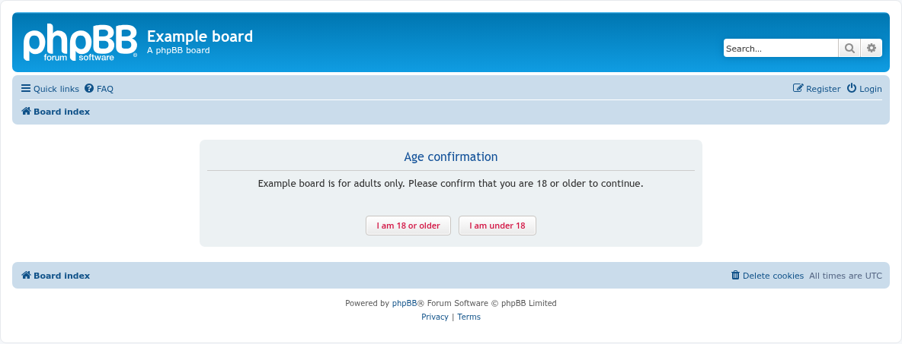
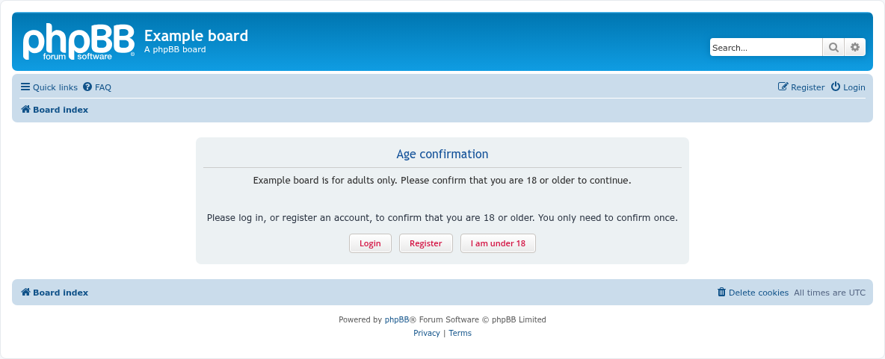
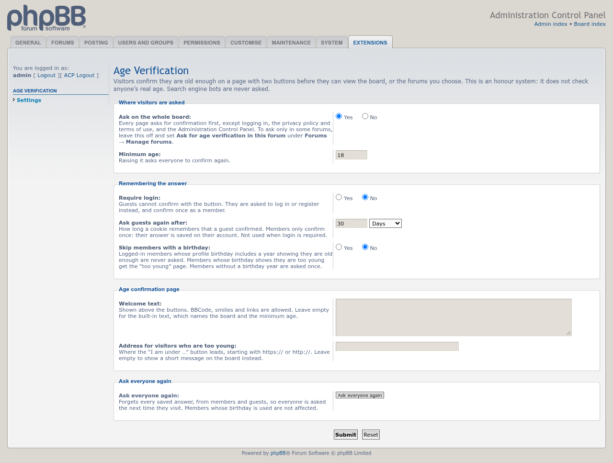
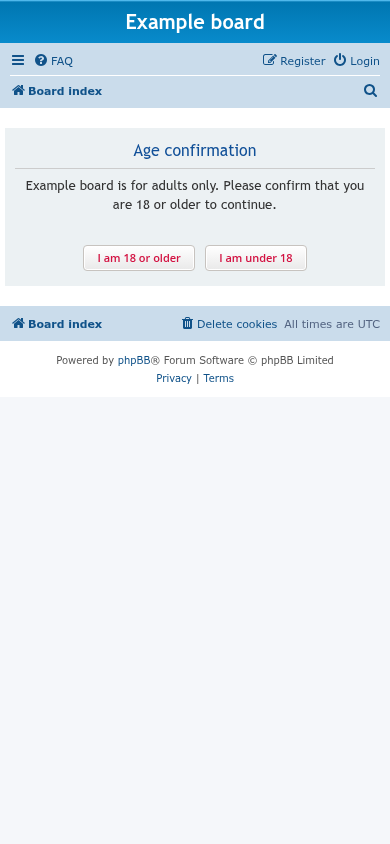

# Age Verification

 

Asks visitors to confirm they are old enough before they can view the board or chosen forums.

Age Verification works on trust. Visitors click a button to say they are old enough, and nothing checks their real age.

## Features

- A confirmation page with your welcome text and two buttons, "I am 18 or older" and "I am under 18". Visitors who confirm go back to the page they asked for.
- Ask on the whole board, or only in the forums you choose. A chosen forum also covers the forums below it and their topics, including replying and posting. Until a visitor confirms, those forums are left out of search results and feeds, and their attachments ask first.
- Any minimum age (18 by default). Raising it asks everyone to confirm again.
- Guests are remembered with a cookie for as long as you set, in minutes, hours or days (30 days by default), then asked again.
- Optionally, require login: guests can't confirm with the button and are asked to log in or register instead.
- Members confirm once. The answer is saved on their account, so another device doesn't ask again. A guest who confirms and then logs in or registers keeps the answer.
- Optionally, use profile birthdays: members whose birthday includes a year showing they are old enough are not asked, and members whose birthday shows they are too young get the "too young" page. Members without a birthday year are asked once.
- "I am under …" goes to an address you choose, or to a short message on the board. That answer is remembered for as long as a "yes" would be, so the visitor can't go back and click the other button.
- An "Ask everyone again" button in the ACP forgets every saved answer.
- Search engine bots are never asked, so the pages can still be indexed. The confirmation page itself is marked `noindex`.
- Guests whose browser refuses the cookie are told so.
- Logging in, logging out, password resets, the privacy policy and terms of use, and the Administration Control Panel never ask, so nobody gets locked out.

## Screenshots

<table>
<tr>
<td></td>
<td></td>
</tr>
<tr>
<td></td>
<td></td>
</tr>
</table>

Click an image for the full size. The [screenshot gallery](docs/images/screenshots/README.md) has the rest.

## Settings

**ACP → Extensions → Age Verification → Settings**

| Setting | Default |
|---------|---------|
| Ask on the whole board | No |
| Minimum age | 18 |
| Require login | No |
| Ask guests again after | 30 days |
| Skip members with a birthday | No |
| Welcome text (BBCode allowed) | Empty: a built-in text naming the board and the age |
| Address for visitors who are too young | Empty: a message on the board |

To ask only in some forums, leave **Ask on the whole board** off and set **Ask for age verification in this forum** under **Forums → Manage forums → (edit a forum)**.

When only some forums ask, their topic titles can still appear on the board index (as the last post), in **Who is online** and in other extensions' lists. Turn it on for the whole board if that matters.

When the whole board asks, feed readers can't confirm, so they get the confirmation page instead of a feed. Turn feeds off under **General → Board configuration → Feed settings** if you don't want them offered.

## Requirements

- phpBB 3.3.19 or later, including phpBB 4.0
- PHP 8.1 or later (phpBB 4.0 itself needs PHP 8.2 or later)
- Visitors need cookies turned on to get past the age confirmation as guests

## Installation

1. Copy the extension to `/ext/phpbbmodders/ageverification`
2. In the Administration Control Panel, go to **Customise → Manage extensions**
3. Enable the **Age Verification** extension
4. Go to **Extensions → Age Verification → Settings** and turn on **Ask on the whole board**, or set **Ask for age verification in this forum** on the forums you choose

Nobody is asked until you do step 4.

## Contributing

Contributions are welcome!

- **Bug reports**: [Open an issue](https://github.com/phpbbmodders/ageverification/issues).
- **Everything else** (questions, feature requests, ideas, general discussion): [Use Discussions](https://github.com/orgs/phpbbmodders/discussions), or the [community forum](https://www.phpbbmodders.com/community/).
- Pull requests are welcome for bug fixes or discussed features.

## Acknowledgments

- Requested on phpBB.com in [Splash Screen](https://www.phpbb.com/community/viewtopic.php?t=2677243), and earlier in the 3.0 MOD request [Age verification](https://www.phpbb.com/community/viewtopic.php?t=1986785).
- Code, tests and documentation written with [Claude](https://www.anthropic.com/claude).

## License

This extension is licensed under the **GNU General Public License v2.0**.

See [license.txt](license.txt) for more information.
