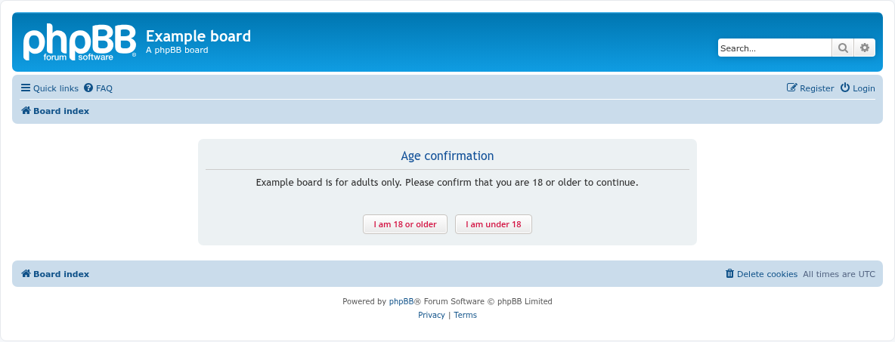
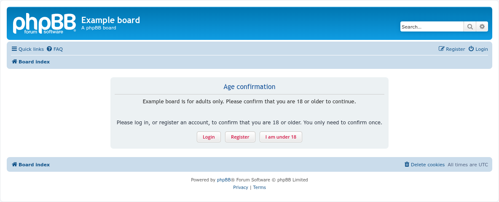
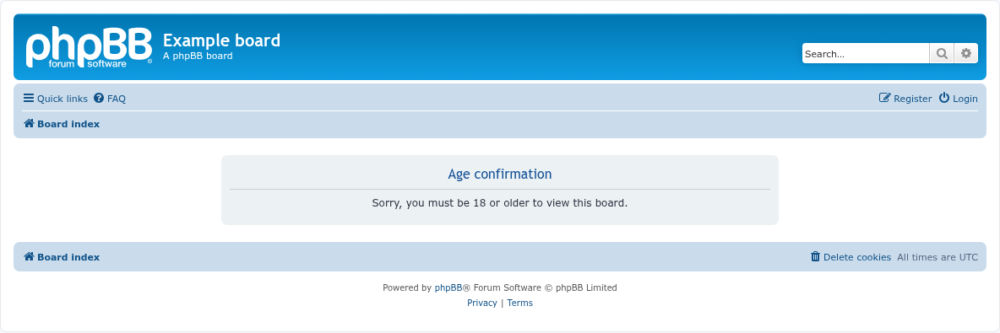
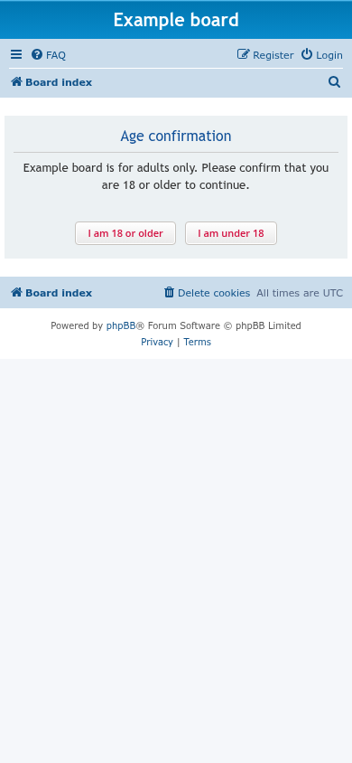
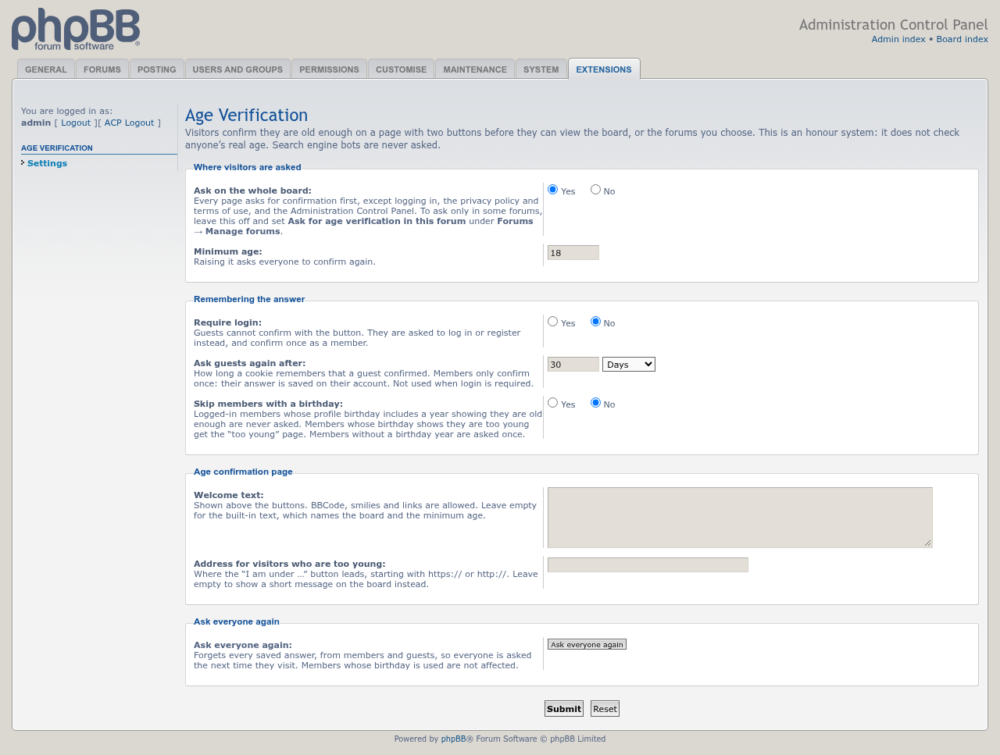
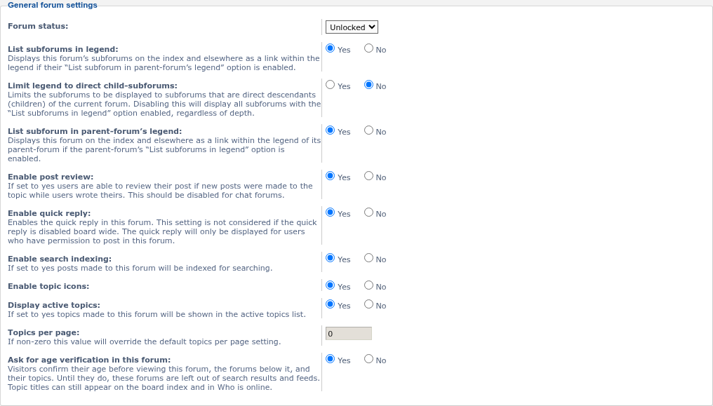

# Screenshots

Age Verification on phpBB 3.3.19 with prosilver. Click an image for the full size.

## The age confirmation page with its two buttons

The age confirmation page a guest sees, with the built-in welcome text.

## The age confirmation page when login is required

The same page with Require login on: guests get Log in and Register instead of the confirm button.

## The too young page

After "I am under 18", with no exit address set. The answer is remembered, so there is no way back to the buttons.

## The age confirmation page on a phone

The age confirmation page on a phone.

## ACP Age Verification settings

ACP → Extensions → Age Verification → Settings.

## The Ask for age verification in this forum setting in Manage forums

The per-forum setting at the end of a forum's general settings in Manage forums.

